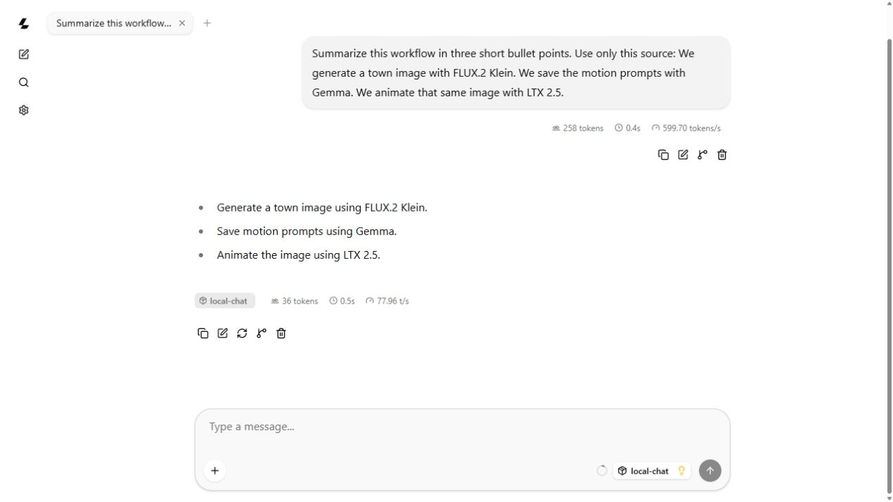

# llama.cpp: your first local chat on AMD / Vulkan

Get a real answer in the built-in browser: download the runtime and small example GGUF, start the server, then ask a question and a follow-up.

**[Download the complete first-chat kit](downloads/FIRST-CHAT-KIT.zip)** · **[First-chat walkthrough](PRACTICE-FIRST-CHAT/README.md)** · [Recorded run](PRACTICE-FIRST-CHAT/example/RECORDED-RUN.json) · [Validation](PRACTICE-FIRST-CHAT/VALIDATION.json)

## Existing guides and downloads

| Machine | Backend used in this series | Guides | Packages |
|---|---|---|---|
| AMD Strix Halo | Vulkan | [English](START-EN.md) / [Deutsch](START-DE.md) | [Vulkan EN](DOLMARIO-VULKAN-EN.zip) / [DE](DOLMARIO-VULKAN-DE.zip) |
| RTX 3080 Ti / RTX 3090 Ti | CUDA | [English](CUDA/EN/START.md) / [Deutsch](CUDA/DE/START.md) | [CUDA EN](DOLMARIO-CUDA-EN.zip) / [DE](DOLMARIO-CUDA-DE.zip) |

[Client connection guides](CLIENTS.md) · [Preserved historical archive](ARCHIV/SAMMELREPO-20261008/ARCHIV-HINWEIS.md)

The new practical run uses AMD/Vulkan; the NVIDIA/CUDA paths remain separate. Earlier blanket statements that the English films55/57 were withdrawn were outdated. Existing downloads and historical files remain available. No fresh NVIDIA run is claimed by the AMD example.

## Deutsch

Der neue Praxisordner zeigt den frisch heruntergeladenen Vulkan-Server mit kleinem Qwen-GGUF, echter Browserantwort und Nachfrage. Die Befehle sind in der [Anleitung](PRACTICE-FIRST-CHAT/README.md) direkt kopierbar. Die bisherigen AMD-Vulkan- und NVIDIA-CUDA-Pakete bleiben separat erreichbar.
